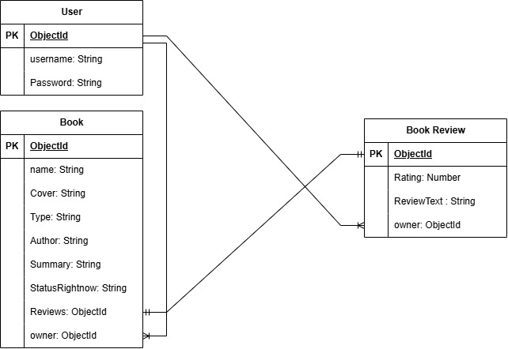

# Project Name
Book Tracker

## Overview
An app used to track your books and post reviews. The site is private to the user, meaning no one else can see your books unless you post your reviews. You can add books, track them, and write reviews about them.

## Screenshots
.png>)
.png>)
.png>)
.png>)
## Technologies Used
1. HTML
2. CSS
3. EJS
4. JavaScript
5. Node.js
6. Express.js
7. Mongoose
8. Method-Override

## Getting Started
1. Create folder for your project and cd into it
2. Clone The Project in your folder
3. Create a .env file with the following 2 values of your database connection:
```javascript
MONGODB_URI=your-mongo-db-connection-string
SESSION_SECRET=your-sectret-key
PORT=3000
```
4. run npm i

## User Stories
1. As a User, I Want to be Able to Add a New Book.
2. As a User, I Want to be Able to Update My Status.
3. As a User, I Want to be Able to Write A Summary.
4. As a User, I Want to be Able to Add My Book Type.
5. As a User, I Want to be Able to Write A Review.
6. As a User, I Want to be Able to Add A Rating.
7. As a User, I Want to be Able to Post My Review in Public.
8. As a User, I Want to be Able to See all Books.

## Database Design


## Routes


| Method | Route | Description |
|---------|-------|-------------|
| GET | / | Home page |
| GET | /books | List all books |
| GET | /books/new | New book form |
| POST | /books | Create book |
| GET | /books/:bookId | View book |
| GET | /books/:bookId/edit | Edit book form |
| PUT | /books | Update book |
| DELETE | /books/:bookId | Delete book |

| Method | Route | Description |
|---------|-------|-------------|
| GET | /reviews | List all reviews |
| GET | /reviews/:reviewId/newReview | New review form |
| POST | /reviews | Create review |
| GET | /reviews/:reviewId/edit | Edit review form |
| PUT | /reviews | Update review |
| DELETE | /reviews/:reviewId | Delete review 


## Features
1. Making an account with username & password.
2. adding a new books to track.
3. viewing all books that the user added.
4. updating your books.
5. deleting your books.
6. writing a review if you finished reading and post it.
7. updating your review.
8. deleting your review.
9. other users can't see your books but the reviews.

## Future Enhancements
1. progress bar when user is currently reading.
2. reviews could be posted private.
3. Categories for books.
4. more options when adding a book.
5. date started reading and date finished.
6. how many books user did read in a year or month (like achivements page).

## Credits
Shaidaa S.Ali 
Shaidasayedali03@gmail.com