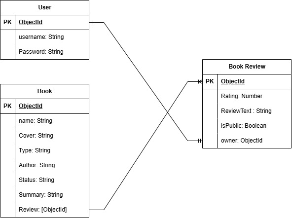

# Project Name
Book Tracker

## Overview

## Screenshots

## Technologies Used

## Getting Started

## User Stories
1. As a User, I Want to be Able to Add a New Book.
2. As a User, I Want to be Able to Update My Status.
3. As a User, I Want to be Able to Write A Summary.
4. As a User, I Want to be Able to Add My Book Type.
5. As a User, I Want to be Able to Write A Review.
6. As a User, I Want to be Able to Add A Rating.
7. As a User, I Want to be Able to Post My Review in Public.
8. As a User, I Want to be Able to See all Books.

## Database Design

## Routes

| Method | Route | Description |
|---------|-------|-------------|
| GET | / | Home page |
| GET | /listings | List all listings |
| GET | /listings/new | New listing form |
| POST | /listings | Create listing |
| GET | /listings/:id | View listing |
| GET | /listings/:id/edit | Edit listing form |
| PUT | /listings/:id | Update listing |
| DELETE | /listings/:id | Delete listing |

## Features

## Future Enhancements

## Credits